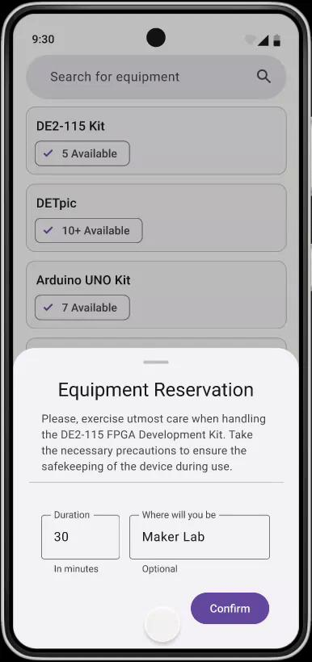
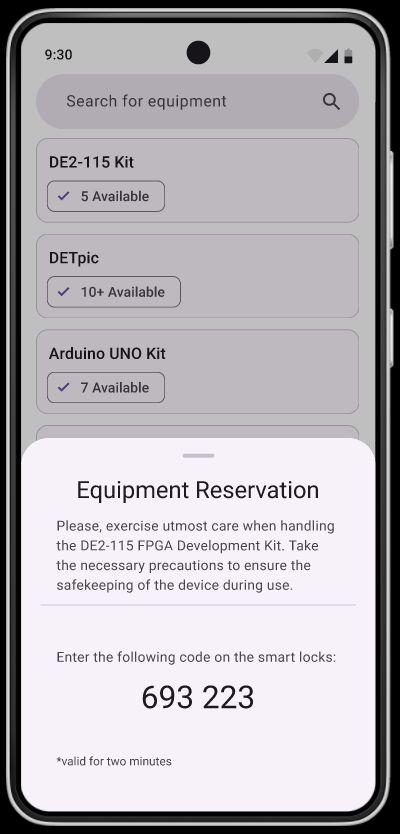
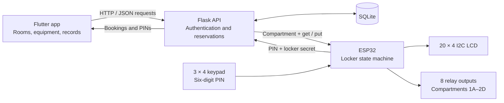
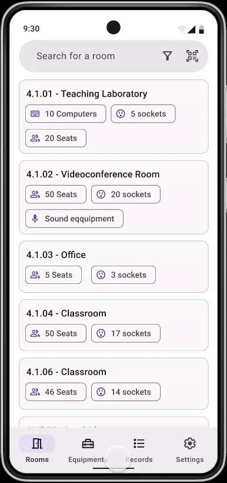
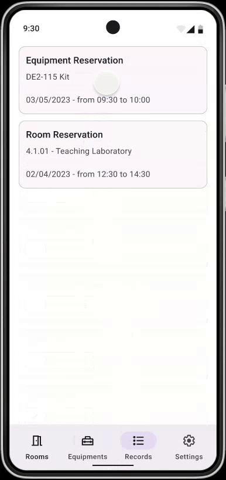

# Gestire - Room Booking and Smart Equipment Lockers

Reserve an FPGA board in an app, receive a six-digit code, and enter it at a locker to collect the board. That is the equipment borrowing flow we built with Gestire: a Flutter application, a Python API, and an ESP32 controlling eight locker compartments.

I built this project with three classmates in 2023 for Análise de Sistemas at the University of Aveiro. It brings room reservations and shared lab equipment into the same application, from finding a suitable space to opening the locker that holds the equipment you need.

[Watch the hardware demo](https://youtube.com/shorts/Ew3Ff9O0Odw). The former hosted application is no longer running; this repository contains the source, original builds, and project reports.

## Why We Built It

The idea came from how we used rooms and equipment at DETI, the university's Department of Electronics, Telecommunications and Informatics. Finding a space meant knowing which rooms were available and whether they had enough seats, sockets, or the right equipment. Borrowing a development board added another problem: getting access to it outside class.

FPGA kits were a useful example. Kits assigned to small groups could sit in manual lockers while nobody in that group was using them. We wanted to make that equipment available as a shared pool, with reservations and a way for students to collect and return it themselves.

Gestire joined those two tasks. A student could find a room for a study session and borrow a board through the same interface. The locker gave the equipment reservation a physical endpoint: a code from the app would open the correct compartment.

## What It Does

- **Find rooms:** search by name or description and filter by minimum seats, power sockets, room type, and an “Available Now” option.
- **Inspect and book a room:** view photos and facilities, then choose a date, start time, duration, and optional reason. The API checks the requested interval against existing reservations.
- **Browse equipment:** search a catalogue of oscilloscopes, Arduino boards, Raspberry Pis, DETPIC boards, and FPGA kits, with availability shown on each card.
- **Collect equipment:** reserve an available item and receive a six-digit PIN for its locker. Unclaimed pickups are scheduled for release after two minutes.
- **Return equipment:** select an equipment reservation from the Records screen and request a new PIN to reopen its compartment.
- **Review reservations:** see room and equipment bookings with their start and end times in one screen.
- **Use the same app on different screens:** the Flutter interface adapts its navigation and card layout to the available width and includes light and dark themes.

## From a Reservation to an Open Locker

The equipment flow connects all three parts of the project:

1. The user selects an available item in the Flutter app and submits a reservation.
2. Flask records the reservation in SQLite, marks the item unavailable, and returns a six-digit pickup code.
3. At the locker, the user enters the code on a keypad. The ESP32 sends it to the API over Wi-Fi, together with the locker's shared secret.
4. The API consumes the code and responds with the compartment identifier, such as `1A`, and the operation: `get` or `put`.
5. The ESP32 shows instructions on its LCD and activates that compartment's relay for ten seconds.

Returning an item uses the same hardware path with a new `put` code. When the API accepts that code, it marks the equipment available again. If a pickup code goes unused, a scheduled callback releases the item and records that it was not collected.

<p align="center">
  
  
</p>

*Original interface mockups from the project presentations: requesting an FPGA kit and receiving its pickup PIN.*



The ESP32 initiates the request and acts on the response. The backend keeps track of users, reservations, and equipment locations; the firmware handles input, feedback, and relay timing.

## The Application

The [Flutter client](client/gestire/lib/) has four main areas: Rooms, Equipment, Records, and Account. Wide windows use a labelled navigation rail, medium windows use a compact rail, and smaller screens use bottom navigation. Room and equipment cards adjust from one to three columns.

Room search combines text filtering in the client with structured filters in the API. Each room also has a detailed inventory: computers, oscilloscopes, signal generators, multimeters, a sound system, a projector, and a whiteboard. Those details help someone choose a room before opening the reservation form.

<p align="center">
  
  
</p>

*Early designs for the room browser and the shared reservation history. The Flutter implementation described here evolved from these layouts.*

Login stores the user's profile and session token locally. On startup, the app checks that token before opening the dashboard. The prototype uses seeded accounts and bcrypt password checks, with a ten-minute session timeout that renews on valid requests. University identity-provider integration appeared in the original plans; the implementation here uses its own authentication.

The repository includes original Android, Linux, and web builds, all produced from the Flutter project.

## The Locker Controller

The [firmware](lockers/src/main.cpp) is written in C++ with the Arduino framework and built through PlatformIO. A state machine takes it through idle, code entry, processing, collection, return, cancellation, and error states.

During code entry, `*` deletes a digit and `#` cancels. Entering the sixth digit submits the request. The LCD then identifies the compartment and tells the user whether to collect or return an item. Invalid codes and failed requests have their own messages before the controller returns to idle.

<p align="center">
  <a href="https://youtube.com/shorts/Ew3Ff9O0Odw">
    
  </a>
</p>

*The assembled locker controller during code entry. Click the photo to watch the hardware demo.*

| Part | Implementation |
| --- | --- |
| Controller | ESP32, PlatformIO `nodemcu-32s` target |
| Input | 3 × 4 matrix keypad |
| Display | 20 × 4 LCD over I2C, address `0x27` |
| Outputs | Eight active-low relay channels, `1A`–`1D` and `2A`–`2D` |
| Communication | HTTP requests over Wi-Fi, JSON responses |
| Opening time | Ten seconds per accepted operation |

## Looking Back at the Prototype

The interesting boundary in this project is between a database reservation and something happening at a locker. A reservation, a collected item, and a returned item are different states. The pickup timeout and separate return code were our first steps towards representing that lifecycle.

There is still a gap between accepting a code and confirming what happened physically. The API changes availability when it validates the code, and the controller opens the relay on a timer. There is no door or item sensor confirming a pickup or return. If I revisited the project, I would start there, along with persisting pending codes so a server restart could recover an operation in progress.

This repository preserves the 2023 prototype. Room overlap checks, return-code expiry, and some client/API fields have known edge cases, described in the [implementation notes](DOCUMENTATION.md#implementation-notes). Room access control and university single sign-on remained outside the implemented system.

## Technologies Used

| Area | Technologies |
| --- | --- |
| Application | Flutter, Dart, Material 3, `http`, `shared_preferences` |
| API | Python, Flask, Flask-CORS, bcrypt |
| Storage | SQLite for users, sessions, rooms, equipment, and reservations |
| Locker firmware | C++, Arduino framework, ESP32, PlatformIO |
| Hardware interfaces | GPIO, matrix keypad, I2C LCD, relay outputs |
| Protocol | HTTP and JSON, ArduinoJson on the ESP32 |
| API tests | Python `unittest` and `requests` |

## Exploring the Repository

```text
backend/             Flask routes, SQLite schema, sample data, and images
client/gestire/       Flutter application and platform projects
client/              Original Android, Linux, and web build archives
lockers/             ESP32 firmware and PlatformIO configuration
images/              Interface mockups and a photo of the locker controller
tests/               Original HTTP API test script
deliverables/        Coursework reports, presentations, and an older firmware copy
DOCUMENTATION.md     Local setup, API reference, hardware wiring, and implementation notes
```

For setup instructions and request examples, see [DOCUMENTATION.md](DOCUMENTATION.md). The original builds retain their old network configuration, so rebuilding from source is the starting point for running the application locally.

## Team and Contributions

Gestire was developed by **Diogo Silva, Ivo Delgado, Martim Carvalho, and Miguel Vila**. My work covered the Flutter interface and API integration, backend authentication and database setup, reservation flows, ESP32 firmware, and API tests. The [original reports and presentations](DOCUMENTATION.md#original-project-material) document the team's requirements, design, and development process.

Released under the [MIT License](LICENSE).
